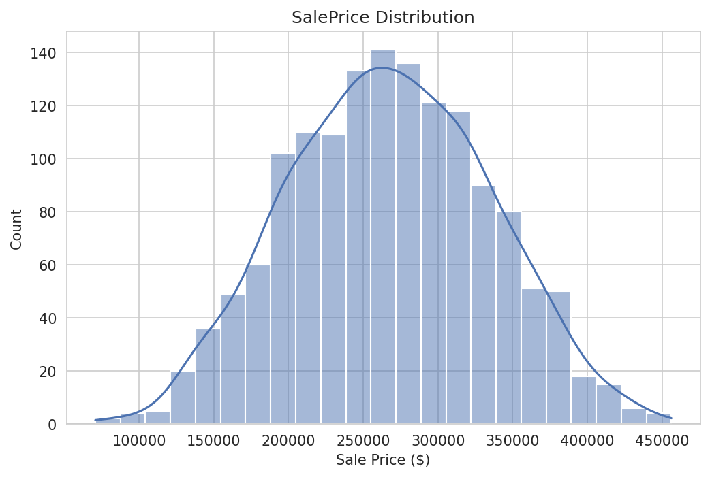
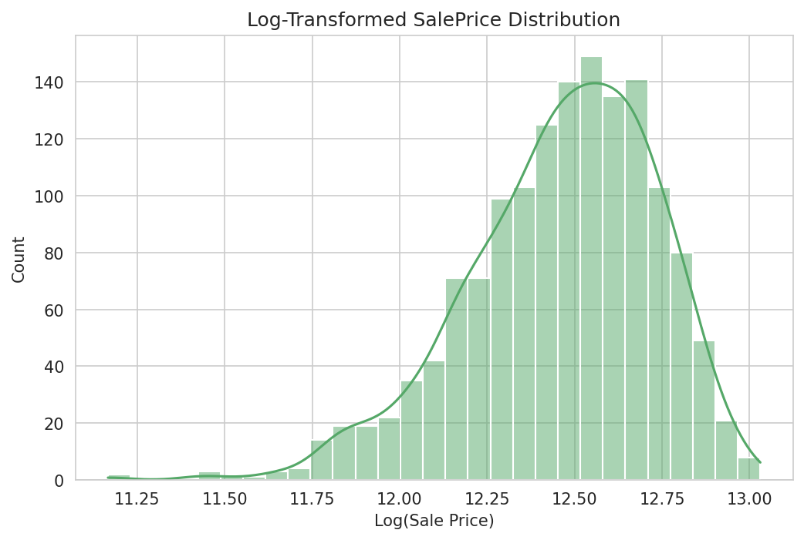
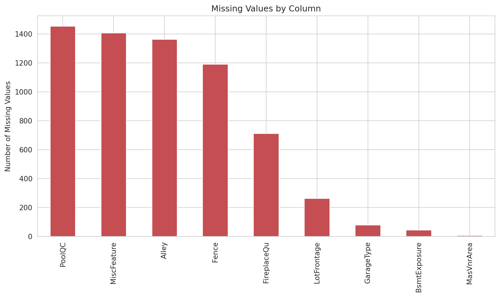
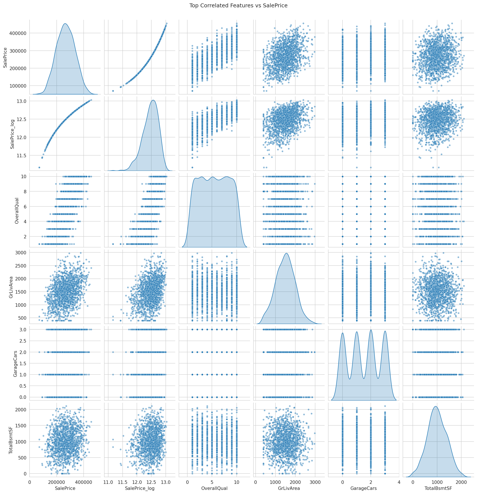

# 🏠 House Price Prediction

Predicting residential home sale prices using the Ames Housing dataset (Kaggle's *House Prices: Advanced Regression Techniques* competition). This project covers the full ML workflow — exploratory data analysis, data cleaning, feature engineering, model building, and evaluation.


---

## 📌 Project Overview

The goal of this project is to predict the final sale price of homes in Ames, Iowa based on 79 explanatory variables describing (almost) every aspect of the property — from square footage and lot size to garage type and overall quality.

**Dataset source:** [Kaggle - House Prices: Advanced Regression Techniques](https://www.kaggle.com/c/house-prices-advanced-regression-techniques)

---

## 🗂️ Project Structure

```
House_Price_Prediction/
│
├── Main.ipynb              # Main notebook (EDA, preprocessing, modeling)
├── train.csv                # Training dataset
├── test.csv                 # Test dataset
├── README.md                 # Project documentation
└── .gitignore
```

---

## 🔍 Exploratory Data Analysis (EDA)

### Dataset Summary
- **Training set:** 1,460 rows × 81 columns
- **Test set:** 1,459 rows × 80 columns (no `SalePrice` — this is the target we predict)

### 1. SalePrice Distribution
The target variable `SalePrice` is right-skewed, meaning most homes cluster around a moderate price range while a smaller number of high-end homes stretch the distribution out.



### 2. Log-Transformed SalePrice
Applying a log transformation makes the distribution closer to normal, which typically improves performance for regression models.



### 3. Missing Values
Several columns have missing data — though many of these aren't true gaps (e.g. `PoolQC` being empty usually just means the house has no pool).



### 4. Feature Correlation with SalePrice
Identified the numeric features most strongly correlated with sale price, including `OverallQual`, `GrLivArea`, `GarageCars`, and `TotalBsmtSF`.



---

## 🛠️ Tech Stack

- **Python 3**
- **pandas / numpy** — data manipulation
- **matplotlib / seaborn** — visualization
- **scikit-learn** — modeling & evaluation
- (planned) **XGBoost / LightGBM** — advanced modeling

---

## 🚀 Workflow

1. **Data Loading & Exploration** — inspect structure, types, and distributions
2. **Data Cleaning** — handle missing values, encode categorical features
3. **Feature Engineering** — create new features (e.g. total square footage, house age)
4. **Model Building** — Linear Regression → Random Forest → XGBoost
5. **Evaluation** — RMSE on log-transformed `SalePrice`
6. **Submission** — generate predictions for Kaggle test set

---

## 📊 Results

| Model              | RMSE (log) |
|---------------------|------------|
| Linear Regression    | TBD        |
| Random Forest         | TBD        |
| XGBoost                | TBD        |

*(Table will be updated as models are trained and evaluated.)*

---

## ▶️ How to Run

```bash
# Clone the repository
git clone https://github.com/YOUR_USERNAME/house-price-prediction.git
cd house-price-prediction

# Install dependencies
pip install pandas numpy matplotlib seaborn scikit-learn

# Open the notebook
jupyter notebook Main.ipynb
```

---

## 📈 Next Steps

- [ ] Complete feature engineering
- [ ] Train and compare multiple regression models
- [ ] Hyperparameter tuning
- [ ] Generate final Kaggle submission
- [ ] Write up key insights and findings

---

## 📄 License

This project is licensed under the MIT License — feel free to use and adapt it.

---

## 🙋 Author

Built as part of a personal machine learning practice project.
